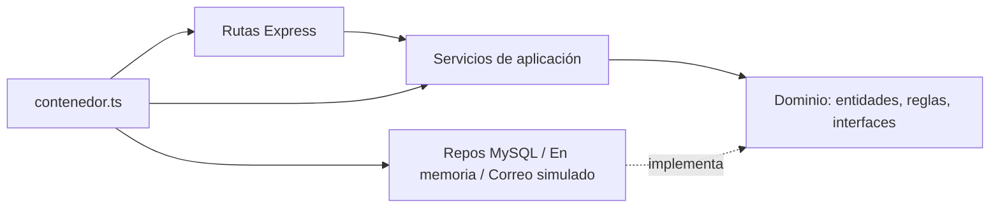

# VetSync 🐾 — Gestión de Citas y Telemedicina Veterinaria


Backend en **Node.js + TypeScript** para clínicas veterinarias: registro de dueños y mascotas con historial médico,
agenda de citas **sin choques de horario** para cada veterinario y **recordatorios por correo (simulados)** antes de cada cita.

Proyecto de la asignación *"Ingeniería de Software Potenciada por IA"*: se construyó con **desarrollo asistido por IA,
pair programming sintético y flujo humano‑IA**, manteniendo el control humano de la arquitectura, la seguridad y la calidad.
Ver [`docs/BITACORA_PROMPTS.md`](docs/BITACORA_PROMPTS.md) y [`docs/REFLEXION.md`](docs/REFLEXION.md).

---

## Requerimientos cubiertos

| # | Requerimiento | Dónde |
|---|---|---|
| 1 | Registro de mascotas y dueños con historial médico | módulos `propietarios`, `mascotas` (historial) |
| 2 | Agendamiento que evita choques de horario por veterinario | módulo `citas` — verificación + inserción **atómica** (transacción con `SELECT … FOR UPDATE` y lectura `FOR SHARE`, ver ADR-0001) |
| 3 | Notificaciones simuladas por correo cuando la cita está próxima | módulo `notificaciones` — job cada 5 min, ventana de 24 h, idempotente |
| 4 | Monolito modular desacoplado, TDD y SOLID | arquitectura hexagonal por módulo, 127 tests, cobertura ≈ 99 %, [`AGENTS.md`](AGENTS.md) |

## Arquitectura

**Monolito modular** con arquitectura hexagonal (puertos y adaptadores) en cada módulo:

```
src/
├── compartido/          errores de dominio, IReloj, IRegistro, validación, helpers HTTP, pool MySQL
├── modulos/
│   ├── propietarios/    dominio · aplicacion · infraestructura · http
│   ├── veterinarios/
│   ├── mascotas/        incluye historial médico
│   ├── citas/           política de agendamiento (reglas puras) + servicio + repos
│   └── notificaciones/  recordatorios, correo simulado, directorio de contactos
├── contenedor.ts        composition root: ÚNICO lugar con `new` de clases concretas
├── app.ts               Express (rutas + middleware de errores)
└── servidor.ts          arranque, job de recordatorios, apagado ordenado
```



- `dominio` no depende de nada; `aplicacion` depende sólo de interfaces (DIP).
- Los módulos se comunican por puertos mínimos (`IConsultaExistencia`, `IDirectorioContactos`, `ICitasPorRecordar`) (ISP).
- Dos persistencias intercambiables (LSP): **en memoria** (desarrollo/tests) y **MySQL** (producción).
- Todas las fechas en **UTC** (ISO 8601 en la API).

## Requisitos

- Node.js 20+ (probado con 22 y 24)
- Docker (opcional, para MySQL)

## Puesta en marcha

```bash
npm install
cp .env.example .env

# Opción A — sin base de datos (persistencia en memoria)
npm run dev

# Opción B — con MySQL 8.4 en Docker (el esquema se carga solo desde database/schema.sql)
docker compose up -d                     # si el 3306 está ocupado: MYSQL_PUERTO=3307 docker compose up -d
# en .env: PERSISTENCIA=mysql (y MYSQL_PUERTO=3307 si lo cambiaste)
npm run build && npm start
```

La API queda en `http://localhost:3000/api` (cambia `PUERTO` en `.env` si el 3000 está ocupado). Prueba rápida:

```bash
curl http://localhost:3000/api/salud
bash scripts/demo.sh http://localhost:3000/api   # recorre los 3 requerimientos de negocio
```

### Variables de entorno

| Variable | Por defecto | Descripción |
|---|---|---|
| `PUERTO` | `3000` | Puerto HTTP |
| `PERSISTENCIA` | `memoria` | `memoria` o `mysql` |
| `MYSQL_HOST` / `MYSQL_PUERTO` | `localhost` / `3306` | Conexión MySQL |
| `MYSQL_USUARIO` / `MYSQL_CONTRASENA` / `MYSQL_BASE_DATOS` | `vetsync` / — / `vetsync` | Credenciales |
| `HORAS_ANTICIPACION_RECORDATORIO` | `24` | Ventana para enviar el recordatorio |
| `MINUTOS_INTERVALO_RECORDATORIOS` | `5` | Frecuencia del job |
| `TOKEN_ADMIN` | — | Token (mín. 16 caracteres) para las rutas `/api/notificaciones` (cabecera `X-Token-Admin`). Sin él, esas rutas responden 403 |

## Scripts

| Comando | Qué hace |
|---|---|
| `npm run dev` | Arranca con `ts-node` |
| `npm run build` / `npm start` | Compila a `dist/` y ejecuta |
| `npm run lint` | ESLint estricto (`no-explicit-any`, convención de nombres) |
| `npm test` | Tests unitarios + integración HTTP en memoria |
| `npm run test:coverage` | Igual, con cobertura (falla si < 80 %) |
| `PRUEBAS_MYSQL=1 npx jest tests/integracion/mysql.test.ts` | Integración contra MySQL real (incluye prueba de concurrencia) |

## Pruebas (TDD)

- **125 tests** en memoria + **2** contra MySQL real. Cobertura: ~99.1 % líneas, ~95.7 % ramas.
- Incluye una matriz de 32 casos límite de `POST /api/citas`, 10 pruebas de seguridad y un test de contrato que compara `docs/openapi.yaml` con las rutas del código.
- Los tests de `agendarCita` se escribieron **antes** de la implementación (fase roja documentada).
- Informe completo: [`docs/INFORME_TESTS.md`](docs/INFORME_TESTS.md).

## CI/CD

[`.github/workflows/ci.yml`](.github/workflows/ci.yml) en cada push / PR a `main`:
1. `npm ci` → `lint` → `build` → tests con cobertura (falla < 80 %).
2. Job de integración con un contenedor **MySQL 8.4** que ejecuta la prueba de concurrencia.

## Documentación

- [API REST](docs/API.md) · [Contrato OpenAPI 3.1](docs/openapi.yaml)
- [ADR-0001: estrategia contra la doble reserva](docs/adr/0001-evitar-doble-reserva.md)
- [Reglas para agentes de IA (AGENTS.md)](AGENTS.md)
- [Bitácora de prompts](docs/BITACORA_PROMPTS.md) · [Reflexión técnica](docs/REFLEXION.md) · [Respuestas íntegras de la IA](docs/bitacora/respuestas/)

## Limitaciones conocidas

- **Sin autenticación de usuarios**: cualquier cliente puede leer historiales (detectado en el code review y en el modelado STRIDE; fuera del alcance de la práctica). Sólo las rutas de administración están protegidas con `TOKEN_ADMIN`. Siguiente paso: JWT + roles y rate limiting.
- El correo es **simulado** (se registra en log y en la tabla `notificaciones`). Entrega *al menos una vez*: si el correo sale pero falla la escritura posterior, puede reenviarse.
- La telemedicina se modela como modalidad de la cita; no incluye videollamada.
